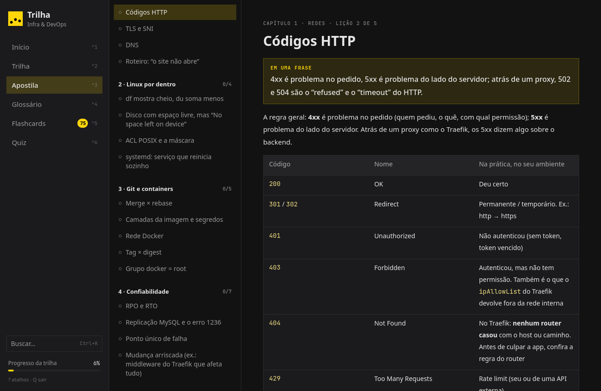

# Trilha



App de estudo de Infra & DevOps para quem aprendeu fazendo e quer entender o **porquê**: apostila por capítulos, glossário, flashcards com repetição espaçada, quiz de cenários, checklist de uma trilha de 6 fases e busca global. Funciona no Linux, no Windows e no macOS. No [Omarchy](https://omarchy.org), segue o tema do desktop ao vivo (cores e cantos).

## Baixar

Na página de [Releases](../../releases) tem um arquivo para cada sistema:

| Sistema | Arquivo | Como abrir |
|---|---|---|
| Linux | `trilha-linux-x86_64.AppImage` | `chmod +x` e execute |
| Windows | `trilha-windows-x64.zip` | Descompacte e abra `trilha.exe` |
| macOS | `trilha-macos.dmg` | Arraste para Aplicativos. Na primeira vez, clique com o botão direito → Abrir, porque o app não é assinado |

No Arch/Omarchy, dá para instalar como pacote, com ícone no launcher (`Super + Space`):

```sh
bin/install      # compila, gera o pacote e instala (pede sudo)
```

## Seções

| Seção | O que faz |
|---|---|
| Início | Resumo do progresso, “continue de onde parou” e os próximos itens da trilha |
| Trilha | 6 fases com checklist (estudo, laboratório e tarefa no ambiente real) |
| Apostila | 6 capítulos e 26 lições: redes, Linux por dentro, git e containers, confiabilidade, IaC e Kubernetes |
| Glossário | 75 termos com filtro por categoria e busca sem acento |
| Flashcards | Sistema Leitner: acertou, sobe de caixa (1, 3, 7, 14, 30 dias). Errou, volta para a 1 |
| Quiz | 45 perguntas de cenário com explicação, por capítulo ou misturadas |

## Atalhos

No macOS, `Ctrl` é `Cmd`.

| Tecla | Ação |
|---|---|
| `Ctrl+1` … `Ctrl+6` | Trocar de seção |
| `Ctrl+K` ou `/` | Buscar em tudo |
| `?` | Mostrar os atalhos |
| `Q` | Sair |
| `Espaço` | Ação principal: marcar a lição como lida e avançar, virar o cartão, ir para a próxima pergunta |
| `Alt+←` / `Alt+→` | Lição anterior / próxima |
| `←` / `→` | Flashcards: errei / acertei |
| `1` a `4`, `Enter` | Quiz: responder e avançar |

## Seu próprio conteúdo

O conteúdo de fábrica é genérico e fica em `src/content/*.json` (`apostila`, `glossario`, `quiz`, `trilha`), compilado dentro do app. Para estudar com os casos do **seu** ambiente sem publicar nada, coloque cópias editadas desses arquivos na pasta abaixo. Cada arquivo que estiver lá substitui o de fábrica:

| Sistema | Pasta |
|---|---|
| Linux | `~/.local/share/trilha/conteudo/` |
| Windows | `%APPDATA%\trilha\conteudo\` |
| macOS | `~/Library/Application Support/trilha/conteudo/` |

A marcação nos textos é só `**negrito**`, `*itálico*` e `` `código` ``. Depois de editar, rode `trilha check` para validar (ids de lição, opções do quiz, colunas das tabelas).

O progresso fica na mesma pasta do sistema, em `progresso.json`. A gravação é atômica, e um arquivo ilegível é copiado para `.corrompido` antes de qualquer coisa.

## Linha de comando

```sh
trilha check [--json]   # valida o conteúdo em uso
trilha progress         # mostra o progresso em JSON
```

No Windows, o `trilha.exe` é um app de janela, então esses comandos não imprimem no console.

## Compilar

É preciso Qt 6.5 ou mais novo, com Qt Quick e Qt Quick Controls.

```sh
bin/build   # Linux/macOS: compila em build/trilha
bin/test    # testes (offscreen)
```

No Windows, use o *Developer Command Prompt* do Visual Studio:

```bat
mkdir build && cd build
qmake ..\trilha.pro
nmake
```

O CI (`.github/workflows/build.yml`) compila e empacota para os três sistemas a cada push. Uma tag `v*` publica uma release.

C++ e Qt Quick, compilado com `qmake`. A lógica fica em `src/backend.cpp`, o tema em `src/theme.cpp` e as telas em `src/*.qml`.

## Licença

MIT. Veja [LICENSE](LICENSE).
